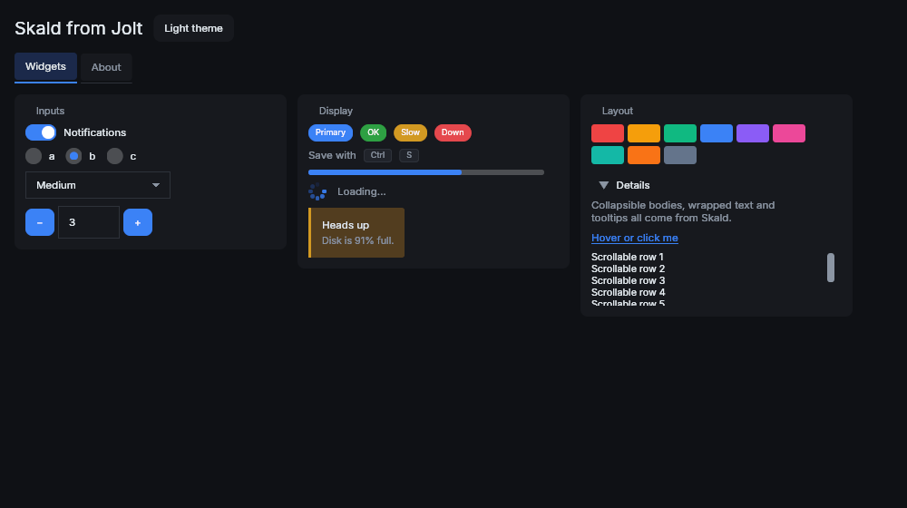
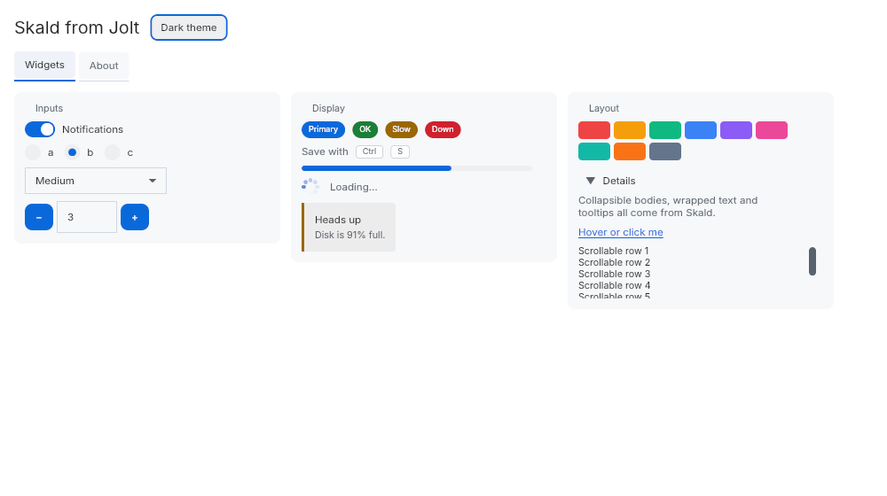
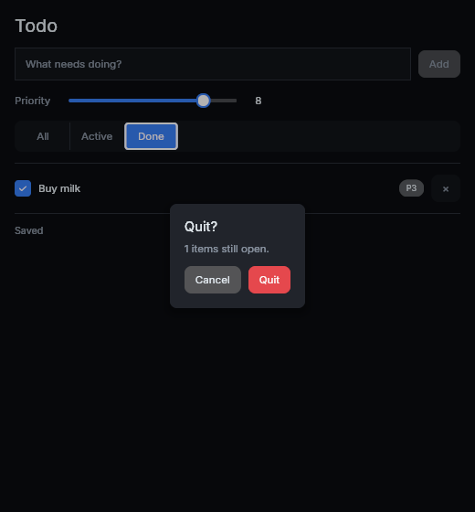
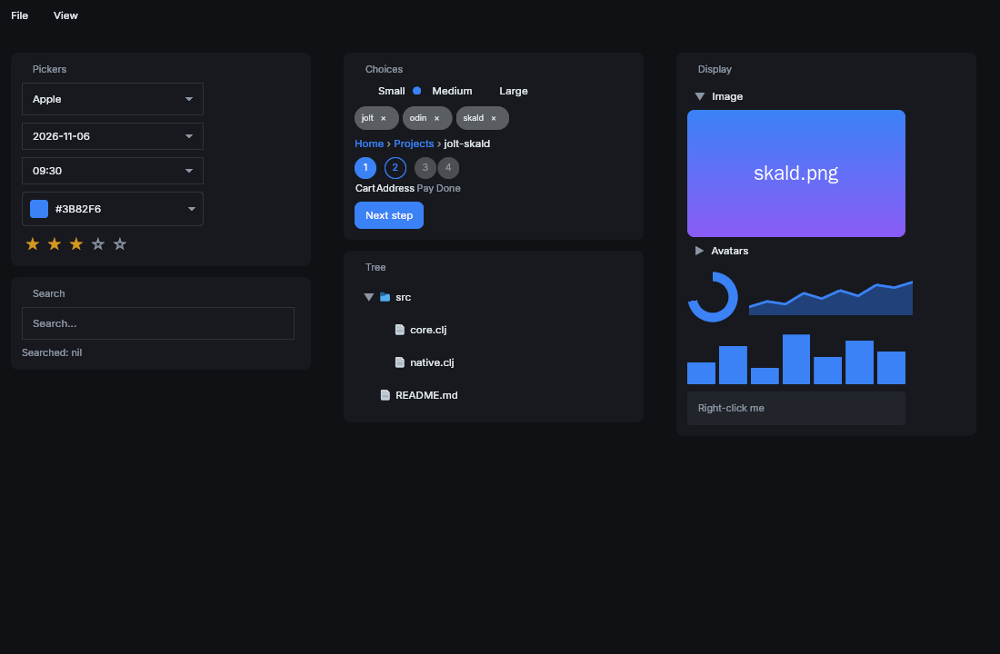
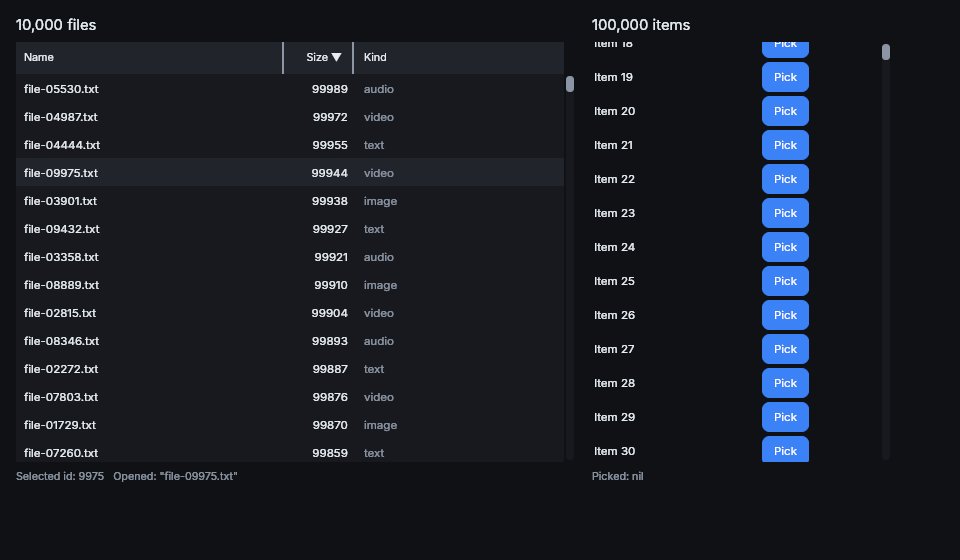
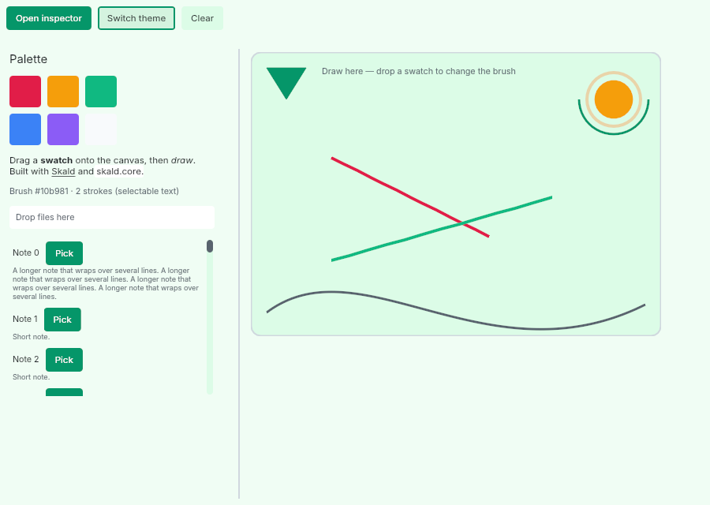

# jolt-skald

Native desktop GUIs in [Jolt](https://jolt-lang.net) (Clojure on Chez Scheme),
rendered by [Skald](https://github.com/BuLEEto/Skald), the Elm-architecture,
Vulkan-rendered GUI framework for Odin.

```clojure
(require '[skald.core :as sk])

(sk/run {:title  "Hello"
         :init   {:count 0}
         :update (fn [s msg]
                   (case msg
                     :inc (update s :count inc)
                     :dec (update s :count dec)))
         :view   (fn [s]
                   [:col {:padding :xl :main-align :center :cross-align :center}
                    [:text {:size :display} (str "Count: " (:count s))]
                    [:spacer :xl]
                    [:row {:spacing :md}
                     [:button {:on-click :dec :width 64} "−"]
                     [:button {:on-click :inc :width 64} "+"]]])})
```



Your state is plain Clojure data. Your view is hiccup. Messages are any
value. Skald does the layout, text shaping, input, focus, and GPU rendering,
at the same frame rate as a native Odin Skald app.

| | |
|---|---|
|  |  |
|  |  |
|  | |

## Status

Tested on Linux x86-64 with Jolt 0.8.24, Odin `dev-2026-11` and SDL 3.2.10.
The end-to-end tests in `test/` drive real windows with real mouse clicks,
typing and window-manager close events, and check the exact state each run
returns. They cover:

- **`jolt run`:** every example, including a stress test that sends 4,010
  messages from 8 threads and checks none is lost or duplicated.
- **REPL workflows over nREPL:** live redefinition, state edits, a broken
  view and its fix.
- **Static `jolt build` binaries:** the same tests again, run from an
  empty directory. The binaries depend only on libc, libm and libtinfo.

macOS and Windows are wired up (library names, build task) but have not
been tested. Skald itself supports both. The static `jolt build` path is
Linux-only for now.

## Requirements

- **Jolt** 0.8.24 or newer.
- **Odin**, to compile the shim once: `jolt native`.
- **Skald**: this repo vendors it as a submodule at `vendor/Skald`, or set
  `SKALD_DIR` to a checkout.
- **Skald's own runtime requirements**: SDL3, a Vulkan loader and driver,
  and Odin's stb static libraries (`make -C $ODIN_ROOT/vendor/stb/src`).
  Skald's
  [PLATFORMS.md](https://github.com/BuLEEto/Skald/blob/main/PLATFORMS.md)
  has per-OS instructions, including building SDL3 on Ubuntu 24.04.

## Setup

```bash
git clone --recurse-submodules <this repo> jolt-skald
cd jolt-skald
jolt native                 # compiles native/skald_jolt -> native/libskald_jolt.so
cd examples
jolt run -m examples.counter
jolt run -m examples.todo
jolt run -m examples.gallery
```

See [Shipping a binary](#shipping-a-binary) and
[REPL workflow](#repl-workflow) below.

To use it from your own project, add it to `deps.edn` as a dependency. Its
`:jolt/native` entry loads the shim automatically:

```clojure
{:deps {io.github.jolt-skald/skald {:local/root "../jolt-skald"}}}
```

## Guide

### The app

`sk/run` opens the window and blocks until it closes. It returns the final
state.

| Option | |
|---|---|
| `:title` | window title |
| `:size` | `[w h]` in logical pixels, default `[800 600]` |
| `:theme` | `:dark` (default), `:light`, or `:system` to follow the OS live |
| `:init` | initial state, or a 0-arg fn returning it |
| `:update` | `(fn [state msg])` returning new state, or `(sk/fx state & cmds)` |
| `:view` | `(fn [state])` returning hiccup |
| `:on-close-request` | message sent when the window's close button is clicked, *instead* of closing; your update must eventually return `(sk/quit)` |
| `:on-key` | message for every key press and release: `{:key :escape :mods #{:ctrl} :pressed? true}`. Not sent while a text field has focus. Held keys repeat |
| `:always-redraw` | render every frame. By default Skald repaints only when something changes |
| `:trace?` | print every message to stderr as it reaches update |

Pass vars (`#'view`, `#'update-state`) and `run` watches them: redefine one
from a REPL and the window repaints immediately.

If `view` or `update` throws, the app keeps running. A failing view shows an
error screen until you fix it. The exception is printed to stderr and kept
for `(sk/last-error)`.

### Views

Elements are `[:tag props? & children]`, with `props` an optional map. Plain
strings render as text, `nil` renders nothing, and lists and lazy seqs are
spliced in, so `(for …)` and `(when …)` work as expected. A function in tag
position is a component: `[item-row item]` calls `(item-row item)`. `:<>`
groups children without adding a container.

**Sizes** accept numbers, or theme tokens: `:xs :sm :md :lg :xl`, plus
`:pill` for radii and `:display` for font sizes. The scale is picked from
the prop. `:size` and `:font-size` read the font scale, `:radius` reads the
radius scale, and everything else reads spacing. So `{:padding :xl}` means
the theme's xl spacing and `{:size :display}` means the display font size.

**Colors** accept a theme role (`:bg :surface :elevated :border :fg :fg-muted
:primary :on-primary :selection :success :warning :danger :transparent`),
which follows theme switches. They also accept hex strings (`"#3b82f6"`,
`"#3b82f680"`) or vectors (`[59 130 246]`, `[0.2 0.5 0.9 0.5]`, or
`(sk/rgba …)`). Hex and vector colors are sRGB, like any design tool. Skald
renders in linear space, and the shim converts.

**Widget IDs.** Skald gives widgets automatic IDs by position. In a list
whose rows can be reordered or removed, wrap each row in
`[:scope {:key id} …]` so its widgets keep their state (focus, text cursor,
hover) with the row and don't pass it to a neighbour. A single widget can
take `:id "some-key"` instead.

### Messages

Any value can be a message: `:save`, `[:remove 42]`, a map, or a fn.
Widgets that report a value combine it with their message:

| Message given | Value `v` | `update` receives |
|---|---|---|
| a fn `f` | `v` | `(f v)` |
| a vector `[:set-name]` | `"Ada"` | `[:set-name "Ada"]` |
| anything else `:set-name` | `"Ada"` | `[:set-name "Ada"]` |

So `[:checkbox {:on-change [:toggle id]}]` delivers `[:toggle id true]`, and
`[:text-input {:on-change #(vector :draft %)}]` delivers `[:draft "text"]`.
Buttons and other widgets with no value deliver the message as given. A fn
in that position is called with no arguments.

Values arrive as plain Clojure data:

| Widget | Value |
|---|---|
| text input, search field, select, combobox | string |
| checkbox, toggle, collapsible | boolean |
| segmented, tabs, radio group, rating, menu, context menu, breadcrumb, accordion, tree, table row | index |
| slider, number input | double |
| date picker | `{:year 2026 :month 11 :day 6}` |
| time picker | `{:hour 9 :minute 30 :second 0}` |
| color picker | sRGB hex string, `"#3b82f6"` (`"#rrggbbaa"` if translucent) |
| chip `:on-close` | the chip's label |
| table `:on-row-select` | `{:row 3 :mods #{:shift}}` |
| table `:on-sort` | `{:column 1 :ascending false}` |
| table `:on-resize` | `{:column 0 :width 270.0}` |
| canvas `:on-press` `:on-drag` `:on-release` | `{:x 12.0 :y 40.0}`, canvas-local |
| drop target `:on-drop` | the dragged `:payload` value itself |
| drop zone `:on-drop` | vector of file paths |
| split `:on-resize` | new first-pane size (double) |
| `open-window` `:on-open` / `:on-close` | the window id |

Dates and times go back in the same shape: `:value`, `:min` and `:max` take
those maps.

### Effects

Return `(sk/fx new-state cmd …)` from update to run commands:

| Command | |
|---|---|
| `(sk/now msg)` | deliver `msg` on the next update pass |
| `(sk/after seconds msg)` | deliver `msg` after a delay |
| `(sk/quit)` | close the app |
| `(sk/set-theme t)` | `:dark`, `:light` or `:system` |
| `(sk/open-file {:filters [["Images" "png;jpg"]] :dir "/tmp" :on-result [:opened]})` | OS Open dialog; `:on-result` gets the path, or `nil` if cancelled. `:filters` and `:dir` are optional (`"*"` matches anything; the default folder is home) |
| `(sk/save-file opts)` | OS Save dialog, same options. It only picks the path; writing the file is up to you |
| `(sk/open-folder opts)` | OS folder picker, same options without `:filters` |

Commands can also be given as a vector of commands.

The OS dialogs are modal, so open one at a time: if two were open at once
and closed in the opposite order, their results would swap. On Linux, SDL
uses the desktop's file picker, or zenity when there is none.
`examples/files.clj` shows all three.

### Other threads

`(sk/dispatch! msg)` can be called from any thread: a `future`, an `agent`,
a `core.async` go block, a callback from another C library. It wakes an idle
UI, and messages sent before `run` starts are queued. Do slow work (I/O,
database queries) on another thread and `dispatch!` the result, so `update`
stays fast.

As on the JVM, Jolt's `future` pool keeps the process alive after `-main`
returns. Call `(shutdown-agents)` after `run` if you used futures (see
`examples/todo.clj`).

Inside a view, `(sk/breakpoint)` returns `:compact`, `:regular` or `:wide`
for the window width, and `(sk/theme-color :primary)` returns a theme color
as sRGB.

## REPL workflow

Develop against a live window: keep the app open, edit code in your editor,
re-evaluate, and watch the window change. There are two ways to set this up.

**Linux and Windows: start the app from the REPL.**

```bash
cd examples && jolt nrepl-server        # then connect your editor
```
```clojure
(require '[skald.core :as sk] '[examples.counter :as c])
(def app (sk/start! c/app))   ; opens the window, returns at once
;; now edit examples/counter.clj and re-evaluate `view` or `update-state`:
;; the window updates immediately
(sk/swap-state! assoc :count 41)   ; poke state
@sk/state                          ; read it
@app                               ; after the window closes: final state
```

**Any OS, including macOS: start the REPL from the app.** macOS requires
the UI on the main thread, so `start!` can't be used there. Instead, the
app's dev entry point starts an nREPL server and then calls `run` on the
main thread. `examples/dev.clj` is a template to copy:

```bash
cd examples && jolt run -m examples.dev  # nREPL on 7888, writes .nrepl-port
```

REPL helpers (all callable from any thread):

| | |
|---|---|
| `(sk/start! opts)` | run the app on its own thread; returns a promise of the final state |
| `(sk/swap-state! f & args)` | apply `f` to the state on the UI thread and repaint. Bypasses `update`, so no commands run |
| `(sk/refresh!)` | repaint, e.g. after changing a helper `run` isn't watching |
| `(sk/running?)` | is a window open? |
| `(sk/last-error)` | the last exception from `view` or `update` |
| `(sk/stats)` | `{:frames n}`, views rendered so far |

Only vars you pass to `run` are watched. If `view` calls a helper fn and
you redefine only the helper, call `(sk/refresh!)`, or re-evaluate the view
as well.

`start!` runs the UI on a plain `Thread`, not a `future`, on purpose. A
future would carry the dynamic bindings of the REPL eval that started it,
including that session's output streams and nREPL state, which outlive the
eval. In testing, that led to a hang when a view threw.

## Shipping a binary

`jolt build` turns an app into one self-contained executable. The shim, SDL3
and everything else are linked in, so the binary needs no `.so` files
beside it:

```bash
# once: SDL3 as a static library (any SDL 3.2 source tree)
cmake -S SDL -B SDL/build-static -DSDL_STATIC=ON -DSDL_SHARED=OFF \
      -DCMAKE_POSITION_INDEPENDENT_CODE=ON
cmake --build SDL/build-static

SDL3_STATIC_DIR=$PWD/SDL/build-static jolt native-static
cd examples && jolt build -m examples.todo -o todo
./todo                       # copy it anywhere; ldd shows only libc, libm, libtinfo
```

How the static link works:

- `jolt native-static` builds `native/static/libskald_jolt_all.a`. That is the
  shim compiled as a static Odin library, plus SDL3, Odin's stb libraries
  and two small C helpers, merged into one archive. `deps.edn` names that
  archive as the shim's `:static` archive, so `jolt build` links it in
  automatically. `jolt run` and the REPL still use the shared library.
- **`native/static_init.c`** starts Odin's runtime (global initialisers and
  `@(init)` procedures). A shared library gets this from the loader; a
  static archive has no entry point of its own, so a C constructor calls
  `sk_startup_runtime` at program load.
- **`native/x11_dl.c`** handles X11. Skald calls six Xlib functions
  directly, and Jolt links static natives with `-Bstatic`, which would mean
  baking in all of Xlib. Instead these six forward to `libX11.so.6`, opened
  with `dlopen` on first use, the same way SDL3 loads X11. Without X11 (on
  Wayland), `XOpenDisplay` returns NULL, which Skald handles.

Graphics drivers still come from the system at runtime, as with any
SDL/Vulkan app: X11 or Wayland and a Vulkan driver, all loaded by SDL with
`dlopen`.

Without the static archive, `jolt build --dynamic` produces a binary that
loads `native/libskald_jolt.so` at runtime. Jolt records that path relative
to the directory you build from, so the binary only finds it when run from
that same directory. Use `--dynamic` for local builds, and static linking
for anything you ship.

Release binaries direct-link their definitions (Jolt's default), so live
redefinition is a REPL and `jolt run` feature, not a built-binary one.

## Element reference

| Element | Children | Main props | Value sent |
|---|---|---|---|
| `:col` `:row` | views | `:spacing :padding :width :height :main-align (:start :center :end :space-between :space-around) :cross-align (:start :center :end :stretch) :bg :radius :shadow :shadow-color :shadow-y` | |
| `:wrap-row` | views | `:spacing :line-spacing :padding :width :bg :radius` | |
| `:flex` | `[:flex weight child]` | `:weight :min-main` | |
| `:scroll` | content | `:size [w h] :wheel-step :track-color :thumb-color :focusable` | |
| `:clip` | content | `:size [w h]` | |
| `:opacity` | content | `:factor` | |
| `:scope` | views | `:key` (required) | |
| `:spacer` | `[:spacer 12]` / `[:spacer :md]` | `:size` | |
| `:rect` | | `:size [w h] :color :radius` | |
| `:text` | the string | `:size :color :max-width` (wraps) `:overflow (:visible :clip :ellipsis) :align` | |
| `:divider` | | `:vertical :color :thickness` | |
| `:button` | label | `:on-click :bg :fg :radius :padding :font-size :width :align :overflow :disabled :id` | |
| `:link` | label | `:on-click :color :color-hover :font-size :underline :disabled` | |
| `:text-input` | | `:value :on-change :placeholder :width :height :multiline :wrap :password :clear-button :escape-clears :invalid :error :max-chars :min-lines :max-lines :disabled` | string |
| `:checkbox` `:toggle` | label | `:checked :on-change :disabled` | boolean |
| `:radio` | label | `:selected :on-select :disabled` | (none) |
| `:slider` | | `:value :min :max :step :width :on-change` | double |
| `:number-input` | | `:value :min :max :step :decimals :width :on-change` | double |
| `:select` | | `:value :options [...] :placeholder :width :on-change` | string |
| `:segmented` | | `:options [...] :selected :on-change` | index |
| `:tabs` | | `:labels [...] :active :on-change` | index |
| `:collapsible` | body | `:title :open :on-toggle` | boolean |
| `:dialog` | content, optional footer | `:open :on-dismiss :width :max-width :padding :bg :border :scrim` | (none) |
| `:tooltip` | the anchor | `:text` | |
| `:progress` | | `:value` (0–1) `:width :height :indeterminate :color-fill :color-bg` | |
| `:spinner` | | `:size :color :period` (s) | |
| `:badge` | label | `:tone (:primary :neutral :success :warning :danger) :bg :fg` | |
| `:alert` | title | `:description :tone` | |
| `:kbd` | label | `:font-size` | |
| `:section-header` | title | `:color :font-size` | |
| `:empty-state` | optional action | `:title :description` | |
| `:combobox` | | `:value :options [...] :free-form :filter :placeholder :width :max-rows :on-change` | string |
| `:date-picker` | | `:value :min :max` (date maps) `:week-start (:locale :monday :sunday) :placeholder :width :on-change` | date map |
| `:time-picker` | | `:value` (time map) `:minute-step :second-step :width :on-change` | time map |
| `:color-picker` | | `:value` (any color) `:width :on-change` | hex string |
| `:rating` | | `:value :max :size :color-on :color-off :on-change` | int |
| `:radio-group` | | `:options [...] :selected :direction (:row :column) :spacing :on-change` | index |
| `:search-field` | | `:value :placeholder :width :on-change :on-submit` | string / (none) |
| `:chip` | label | `:tone :on-close` | label |
| `:breadcrumb` | | `:segments [...] :separator :on-select` | index |
| `:stepper` | | `:labels [...] :active :disc-size` | |
| `:avatar` | initials | `:size :bg :fg` | |
| `:image` | | `:src` (file path) `:size [w h] :fit (:cover :contain :fill :none) :radius :tint :border :border-width` | |
| `:gauge` | | `:value` (0–1) `:size :thickness :color :track-color` | |
| `:sparkline` | | `:values [...] :size [w h] :min :max :color :fill :grid :y-unit` | |
| `:bar-chart` | | `:values [...] :size [w h] :min :max :color :gap :grid :y-unit` | |
| `:accordion` | one view per section | `:titles [...] :active :on-toggle` | index |
| `:context-menu` | the right-click target | `:items [...] :anchor (:cursor :child) :width :on-select` | index |
| `:menu` | | `:items [...] :width :on-select :on-dismiss` | index / (none) |
| `:menu-bar` | `[:menu "File" items…]` | see [Menus](#menus) | |
| `:tree` | | `:rows [{:depth :label :expandable :expanded :selected :icon}] :width :indent :row-height :on-toggle :on-select` | row index |
| `:toast` | message | `:visible :kind (:info :success :warning :danger) :anchor (:top-left … :bottom-right) :dismiss-after :on-close` | (none) |
| `:virtual-list` | | see [Lists and tables](#lists-and-tables); `:variable-height true` for rows that measure themselves | |
| `:canvas` | | see [Canvas](#canvas) | point |
| `:rich-text` | strings and span tags | see [Rich text](#rich-text) | link target |
| `:drag-source` | child, optional drag visual | `:payload` (any value) `:kind` | |
| `:drop-target` | child | `:accepts` (kind) `:id :on-drop` | payload |
| `:drop-zone` | child | `:on-drop` (files from the OS) | paths |
| `:split` | first, second | `:first-size :direction (:row :column) :min-first :min-second :divider-thickness :on-resize` | size |
| `:grid` | cells, row-major | `:columns [120 0 80]` (0 = flex) `:spacing :spacing-x :spacing-y :padding :width :bg :radius` | |

`:text` also takes `:selectable true`, which lets the user select and copy
the text.
| `:table` | | see [Lists and tables](#lists-and-tables) | |

### Menus

```clojure
[:menu-bar
 [:menu "File"
  [:menu-item {:on-click :new :shortcut "Ctrl+N"} "New"]
  [:menu-separator]
  [:menu-item {:on-click :quit :shortcut "Ctrl+Q"} "Quit"]]
 [:menu "View"
  [:menu-item {:on-click :zoom :checked true} "Zoom"]]]
```

Shortcuts are strings: modifiers `Ctrl`, `Shift`, `Alt`, and `Super` (or
`Cmd`), then a key (`A`–`Z`, `0`–`9`, `F1`–`F12`, `Enter`, `Page-Down` …),
joined with `+`. They are shown in the menu and also work from the keyboard
while the window has focus. Menu items take `:disabled` and `:checked`.

### Keyboard

`[:shortcut {:keys "Ctrl+K" :on-press :palette}]` anywhere in the view
fires a shortcut without a menu bar. It draws nothing and only works while
it is in the view, so shortcuts can depend on state. Modifiers match
exactly, and shortcuts fire even while a text field has focus.

For raw keys (arrows in a game, Escape to cancel), pass `:on-key [:key]` to
`run`. Keys arrive as keywords: `:a`–`:z`, `:n0`–`:n9`, `:f1`–`:f12`,
`:up`, `:page-down`, `:escape`, `:enter`, `:space`, `:left-bracket` …
Modifier keys alone don't arrive. `examples/keys.clj` shows both.

### Lists and tables

`[:virtual-list]` and `[:table]` only build the rows that are on screen. You
give them a row count and a function from row index to hiccup, so 100,000
rows cost no more than 20:

```clojure
[:virtual-list {:count 100000 :row-height 32 :size [300 420]
                :key identity                     ; stable row identity (optional)
                :row (fn [i] [:row [:text (str "Item " i)]
                                   [:button {:on-click [:pick i]} "Pick"]])}]

[:table {:columns [{:label "Name" :width 220 :sortable true :resizable true}
                   {:label "Size" :width 120 :sortable true :align :end}
                   {:label "Kind" :weight 1}]     ; width 0/omitted = flex
         :count (count rows) :row-height 28 :size [560 420]
         :row (fn [i] (let [r (nth rows i)]       ; one view per cell
                        [[:text (:name r)] [:text (str (:size r))] [:text (:kind r)]]))
         :key (fn [i] (:id (nth rows i)))
         :selected? (fn [i] (= (:id (nth rows i)) selected-id))
         :focus-row selected-index                ; where Up/Down/Home/End start from
         :sort-column 0 :ascending true
         :on-row-click [:select] :on-row-activate [:open]   ; row index
         :on-sort [:sort] :on-resize [:resize]              ; maps, see Messages
         :on-row-context [:menu]}]
```

The table only draws the sort state and column widths; keeping them is your
job. On `:on-sort`, re-sort your rows and pass the new `:sort-column` and
`:ascending`. On `:on-resize`, store the width and pass it back in
`:columns`. `:on-row-activate` fires on double-click and on Enter.

Rows are built during layout, after `view` returns, so the row fn should be
a pure function of data you already have. Sort or filter once (memoize it,
as `examples/data.clj` does), not inside `:row`. A row fn that throws shows
an error cell instead of crashing.

For multi-select, use `:on-row-select` instead of `:on-row-click`. It
delivers `{:row i :mods #{:shift :ctrl :alt :super}}` (Shift+Up/Down from
the keyboard arrive with `:shift`). `sk/select-rows` turns that into the
next selection, keyed by row identity so it survives re-sorting:

```clojure
:select (update s :sel sk/select-rows v key-of index-of)
;; s :sel = {:selected #{key …} :anchor key :focus key}
;; table: :selected? #(contains? (get-in s [:sel :selected]) (key-of %))
;;        :focus-row (index-of (get-in s [:sel :focus]))
```

Plain click selects one row, Ctrl/Cmd-click toggles, Shift-click selects
the range from the anchor. `examples/data.clj` shows the full wiring.

### Layout: what fills, what doesn't

`:split`, and a `:grid` with flex columns, fill the space their parent
gives them and have no natural width of their own. A `:col` with the
default `:cross-align :start` gives each child only its natural width, so
those come out zero-wide. Put them in a column with `:cross-align
:stretch`, or inside `[:flex 1 …]` (as `examples/studio.clj` does). A grid
whose columns are all fixed sizes itself.

### Canvas

```clojure
[:canvas {:size [520 360] :cursor :crosshair
          :on-press [:down] :on-drag [:move] :on-release [:up]   ; {:x :y}, canvas-local
          :draw [[:rect 0 0 520 360 {:color :surface :radius 12}]
                 [:rect-outline 0 0 520 360 {:color :border :width 1 :radius 12}]
                 [:line 10 10 200 80 {:color :primary :width 2}]
                 [:circle 460 60 24 {:color "#f59e0b"}]
                 [:ring 460 60 34 {:width 3}]
                 [:arc 460 60 44 0 3.14159 {:width 2}]             ; radians
                 [:bezier [20 330] [140 240] [300 420] [500 320] {:width 2}]
                 [:polyline [[0 0] [40 30] [80 10]] {:width 3}]
                 [:polygon [[20 20] [70 20] [45 60]] {:color :primary}]
                 [:text 90 28 "label" {:size 13 :color :fg-muted}]]}]
```

`:draw` is data: a seq of commands, so build it with `for`, `concat` and
`map` from your state. Colors take theme roles, hex or vectors, like
everywhere else. The canvas is drawn from that data each time the view
renders. There is no callback into your code during drawing. The pointer
messages make it interactive: `examples/studio.clj` is a paint program in
about 30 lines.

### Rich text

```clojure
[:rich-text {:size 15 :max-width 400 :on-link [:open]}
 "Plain, " [:b "bold"] ", " [:i "italic"] ", " [:code "code"] ", "
 [:link {:href "https://example.com"} "a link"] ", and "
 [:span {:color :primary :underline true :strike true :size 18} "custom"]
 [:b "nesting " [:i "works"]]]
```

Tags: `:b`/`:strong`, `:i`/`:em`, `:u`, `:s`, `:code`, `:link` (with
`:href`), and `:span` with any of `:color :size :bold :italic :underline
:strike :bg`. `:on-link` receives the clicked `:href`. Add `:selectable
true` to let the user select the text.

### Drag and drop

```clojure
[:drag-source {:payload {:card 42} :kind "card"}
 [card-view 42]                        ; what's shown in place
 [card-ghost 42]]                      ; optional: what follows the cursor

[:drop-target {:id "done" :accepts "card" :on-drop [:move-to :done]}
 [:col {:bg (if (sk/drag-over? "done" "card") :selection :surface)} …]]
```

The payload can be any value; `:on-drop` receives it, so the example above
delivers `[:move-to :done {:card 42}]`. `(sk/dragging)` returns the payload
of a drag in progress, and `(sk/drag-over? id kind)` reports whether one is
over a target, for highlighting. `[:drop-zone {:on-drop [:files]} child]`
receives a vector of paths for files dragged in from the OS.

### Windows

```clojure
(sk/fx s (sk/open-window {:title "Inspector" :size [320 200]
                          :on-open [:opened] :on-close [:closed]}))
;; update gets [:opened id]; keep the id in state.
(defn view [s]
  (if (sk/main-window?) (main-view s) (inspector-view s)))
;; close it with (sk/close-window id). Closing the main window quits.
```

All windows share one state and one `update`. `view` is called once per
window per frame, with `sk/*window*` set to the window being drawn.

### Custom themes

```clojure
(def rose {:base :dark                        ; or :light
           :color {:primary "#e11d48" :bg "#120a0e" :surface "#1d1217"}
           :spacing {:md 12} :radius {:md 12 :lg 16} :font {:size-md 14}})

(sk/run {… :theme rose})                       ; at start
(sk/fx s (sk/set-theme rose))                  ; or switch at runtime
```

The base theme supplies everything you don't set. The color roles are
`:bg :surface :elevated :border :fg :fg-muted :primary :on-primary
:selection :success :warning :danger`. Spacing and radius fields are `:xs`
through `:xl` (plus `:pill` for radius). Font fields are `:size-xs`
through `:size-xl` and `:size-display`. An unknown field is an error, not
silently ignored. Theme roles used in views, including in canvas commands,
follow a switch.

A prop's name is Skald's parameter name in kebab case. The property list
itself comes from the shim at load time (`sk_enum_name`), so it can't drift
out of sync with the Odin side.

## How it works

Skald is generic over the app's `State` and `Msg` types. Its widgets take
Odin procs, named arguments and variadics, none of which can cross a C
boundary. `native/skald_jolt/skald_jolt.odin` makes Skald callable from C:

- It instantiates Skald once, with `State = {gen}` and
  `Msg = {tag, kind, i, f, s}`. `tag` is a number the Jolt side maps back to
  your Clojure message value. `kind` and `i`/`f`/`s` carry the widget's
  value. Skald's `*_payload` widget variants pass the tag through, so one
  Odin proc serves every widget instance.
- It builds views with a **stack machine**. Jolt writes props into a shared
  register (`sk_pf`, `sk_pc`, `sk_ps`, …), then calls a builder
  (`sk_button`). A container is bracketed: `sk_begin`, then its children,
  then `sk_col`. Builders run in the same order as a hand-written Odin view
  (children before parents), so Skald's automatic IDs, focus order and
  interaction logic behave exactly as in Odin.
- It exports a plain C interface (about 60 `sk_*` symbols). `skald.native`
  binds it 1:1, and `skald.core` puts the hiccup and message layer on top.

`sk_run` is bound `:blocking`, and the update and view callbacks are
`:collect-safe`. That's Jolt's documented pattern for a native UI loop: the
UI thread parks in Skald without stopping garbage collection on other Jolt
threads. Message tags from a view are valid until that frame's messages
have gone through update. Tags for commands and `dispatch!` live in a
separate thread-safe table and are freed when delivered.

`dispatch!` from another thread goes through the shim's mailbox. A Skald
`cmd_thread` worker waits on a semaphore, and Skald's own SDL wake-up event
brings an idle UI back to life. The worker is released on quit and on
window close, so Skald's shutdown (which waits for its worker threads)
can't hang.

## Not bound yet

These Skald features have no binding yet:

- **Data and layout:** `form_row`, and table extras (marquee selection,
  zebra striping).
- **Drawing:** canvas images and gradients (the canvas has shapes, paths
  and text), and per-span fonts in rich text.
- **Drag and drop:** drags that carry data out to other apps.
- **Input:** the emoji picker and the chat input.
- **Windows:** per-window options beyond title and size (position, flags,
  state), and the focus and geometry callbacks.
- **Dialogs and files:** Skald's prebuilt confirm and alert dialogs
  (`:dialog` covers the same ground), and async file I/O.
  For file work, use Jolt's own I/O on a thread with `dispatch!`.
- **Theming:** custom fonts.

Each new widget follows the same pattern: an `sk_*` export in the shim that
reads the props, one `defcfn` in `skald.native`, and one entry in
`skald.core/elements`.

## Caveats

- **Skald runs on the thread that calls `run`,** and that thread stays
  inside the run loop until the window closes. Other threads keep running
  normally (see `dispatch!`). Only one app runs per process at a time.
- **Watch for shadowed names when destructuring.** Destructuring state keys
  named `filter`, `update` and so on shadows `clojure.core` inside that
  function. This repo's own bugs during development came from exactly this.

## Tests

```bash
test/run_all.sh          # everything
test/run_all.sh unit     # windowless unit tests only, under a second
```

**Unit tests** need only the built shim (for its enum tables). They swap
every `skald.native` call for a recorder, so no window or GPU is involved:

- **`core_test`**: hiccup to shim calls (nesting, splicing, components,
  `:scope`, `:flex` weights), size tokens and their scales, every color
  form, widget-specific props, rich text, canvas commands, the menu bar,
  message combining from view through `on-update` to `update`, `fx`
  commands and persistent tags, and the errors for bad input.
- **`select_rows_test`**: the `select-rows` helper.

**End-to-end tests** drive real windows. On Linux they run under Xvfb with
xdotool. On macOS they run on the real desktop: `test/mac/xdotool.swift`
stands in for the xdotool subset the scripts use and is compiled on first
run. The terminal needs Accessibility and Screen Recording permission, and
nothing else may take the mouse or keyboard while the tests run.
`e2e_files` is skipped on macOS.

They use clicks, typing, a
held mouse press for the slider, and window-manager close events. A software
Vulkan driver (lavapipe) is enough. Each test checks the exact state `run`
returns.

- **`e2e_counter`**: clicks, close button, clean exit.
- **`e2e_todo`**: text input, keyed rows, all four value types, `fx` with
  `after`, `dispatch!` before `run` and from a `future`, and the
  confirm-on-close dialog (Cancel, then Quit).
- **`e2e_gallery`**: every bound widget, theme switching, tabs.
- **`e2e_stress`**: 8 threads × 500 `dispatch!` calls plus 10 queued before
  `run`, all delivered exactly once.
- **`e2e_widgets`**: every widget added in the second batch, by mouse and
  keyboard. It covers combobox, date, time and color pickers, rating,
  search with submit, radio group, chips, breadcrumb, tree, context menu,
  the menu bar by click and by `Ctrl+N`, a toast that dismisses itself, the
  accordion, and quitting via the `Ctrl+Q` menu shortcut. It then checks the
  final state and message log.
- **`e2e_data`**: a 10,000-row table and a 100,000-row virtual list. Clicks
  on the header sort it both ways, rows are selected by click and by the
  Down key, a double-click opens a row, Shift-click, Shift+Down and
  Ctrl-click build a multi-row selection, a column is resized by dragging,
  and a button is clicked inside a list row after scrolling (rows are built
  during layout).
- **`e2e_keys`**: arrow keys and Escape through `:on-key` (presses and
  releases), a `[:shortcut]` that fires once per Ctrl+K, and typing in a
  text field that neither moves the square nor reaches `:on-key`.
- **`e2e_files`**: Open picks a file, Open again and cancel (`nil`),
  Save as writes to the chosen path, and Pick folder cancels. Typed into
  zenity's dialogs; skipped when zenity isn't installed.
- **`e2e_studio`**: canvas drawing with real mouse drags (each stroke's
  points arrive as press, drag and release events), dragging a swatch onto
  the canvas (the drop delivers the payload value and changes the brush
  colour), a rich-text link, a variable-height list, a second window opened
  and then closed from its own button, a custom theme switch, and resizing
  the split pane by dragging.
- **`e2e_repl`**: over nREPL, using a small client in `test/nrepl.py` that
  speaks the same protocol as CIDER and Calva. It covers `start!`,
  redefining `view` (the window repaints with no input), `swap-state!`,
  redefining `update` and then clicking, a view that throws and its fix,
  closing the window, and starting a second app in the same process.
- **`e2e_repl_main`**: the macOS-safe pattern. `examples.dev` starts nREPL
  and runs the UI on the main thread; the test redefines code, closes the
  window, and checks that the process exits.
- **`e2e_build.sh`** (separate; needs `jolt native-static`): builds every
  example as a static binary, checks with `ldd` that none depends on SDL3,
  X11 or the shim, then runs the four app tests against the binaries from
  a scratch directory.

Requirements: Xvfb, xdotool, xwd, ImageMagick, python3-xlib, SDL3, and a
Vulkan driver. `e2e_files` also needs zenity.

## License

zlib, matching Skald. Skald is © its authors (zlib), and its bundled Inter
font is under the SIL OFL 1.1. Jolt is EPL-1.0.
